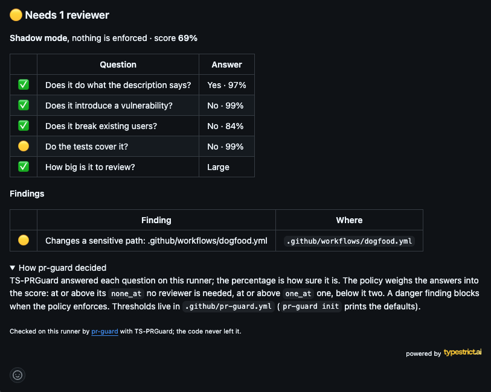
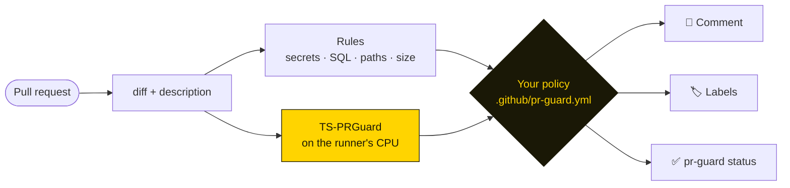

<p align="center">
  <a href="https://huggingface.co/typestrict/TS-PRGuard"></a>
</p>

<h1 align="center">pr-guard</h1>

<p align="center">
  <b>How many people should review this pull request?</b><br>
  A small model reads the diff on your own runner and answers, under a policy you write.
</p>

<p align="center">
  <a href="https://huggingface.co/typestrict/TS-PRGuard"></a>
  <a href="https://huggingface.co/typestrict/TS-PRGuard"></a>
  
  
  <a href="LICENSE"></a>
  <a href="https://typestrict.ai"></a>
</p>

---

pr-guard reads the diff and the description of a pull request, asks [TS-PRGuard](https://huggingface.co/typestrict/TS-PRGuard)
(150M parameters, 8-bit ONNX) five questions about it, adds deterministic checks for secrets, destructive SQL and
sensitive paths, and lets a YAML policy decide: **no reviewer, one or two, or blocked**. It comments on the pull
request, labels it and sets one status you can make required.

- **Private by design.** No API, no key, no telemetry: the model runs on the CI runner and the code never leaves it.
- **Fast enough for every pull request.** 5 to 20 seconds on a stock `ubuntu-latest`, about 650 MB of memory.
- **Everywhere your code is.** GitHub, GitLab and Bitbucket; GitHub Actions, GitLab CI, Bitbucket Pipelines, CircleCI,
  Bitrise, Jenkins, pre-commit, or any shell.
- **Your model if you want.** Train one on your own pull requests with [typestrict.ai](https://typestrict.ai) and point
  the policy at it.

<p align="center"></p>

## Quick start

```yaml
# .github/workflows/pr-guard.yml
on: pull_request
permissions:
  contents: read
  pull-requests: write   # the comment and labels
  statuses: write        # the pr-guard status
jobs:
  pr-guard:
    runs-on: ubuntu-latest
    steps:
      - uses: actions/checkout@v4
        with: { fetch-depth: 0 }
      - uses: typestrict-lab/pr-guard/integrations/github@main
```

It starts in **shadow mode**: it reports on every pull request and never fails one. When its answers look right on your
code, write `mode: enforce` in `.github/pr-guard.yml` and make `pr-guard` a required status.

On a laptop:

```sh
curl -fsSL https://raw.githubusercontent.com/typestrict-lab/pr-guard/main/install.sh | sh
pr-guard check                     # this branch against its merge base
pr-guard check --staged --no-model # the staged changes, rules only, instant
```

## How it decides



| The model is asked | Default in the policy |
|---|---|
| Does it do what the description says? | warns above 40% that it does not, blocks above 70% |
| Does it introduce a vulnerability? | warns above 70% |
| Does it break existing users? | warns above 50% |
| Do the tests cover it? | warns above 50% that they do not |
| How big is it to review? | warns when very large |

The answers weigh into a score; 85% or more needs no reviewer, 60% or more one, below that two. The comment shows the
arithmetic for each pull request.

## The policy

```yaml
mode: shadow            # or enforce
model: pr-guard:1       # pr-guard:latest, hf:you/your-model, https://cdn…, or a directory

reviewers: { none: 85%, one: 60% }

questions:
  vulnerability: { weight: 3, warn: 70%, block: 90% }

rules:
  secrets: block
  sensitive_paths: { level: warn, paths: [infra/**, "**/auth/**"] }
```

Every key is optional. `pr-guard init` prints the whole default, commented; [docs/policy.md](docs/policy.md) explains
each key and how to choose the model.

## Learn more

| | |
|---|---|
| [Policy and model](docs/policy.md) | the file, how a verdict is made, `pr-guard:1`, `latest`, your own Hugging Face repo or a CDN |
| [Install and CI](docs/ci.md) | install script, Homebrew, Docker, the GitHub Action, pre-commit, GitLab, Bitbucket, CircleCI, Bitrise, Jenkins, output formats |
| [Publishing to the host](docs/hosts.md) | the comment, labels and status on GitHub, GitLab and Bitbucket, tokens, required reviewers |
| [Development](docs/development.md) | examples, tests, releases, how ONNX Runtime is linked |
| [TS-PRGuard on Hugging Face](https://huggingface.co/typestrict/TS-PRGuard) | the model card: questions, results against Jev, training data |

## License

Apache-2.0. TS-PRGuard is Apache-2.0 too.

<p align="right">
  <sub>powered by</sub>&nbsp;<a href="https://typestrict.ai"><picture><source media="(prefers-color-scheme: dark)" srcset="https://typestrict.ai/status/logo-dark.png"></picture></a>
</p>
