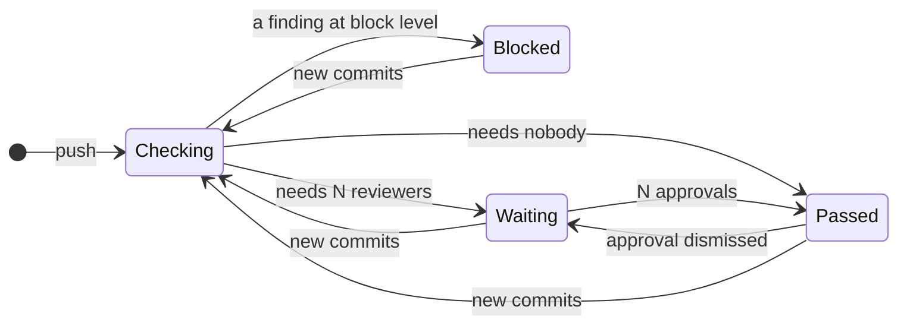

# Publishing to the host

Where the pull request lives is a separate question from where the job runs: a Jenkins job can review a GitHub pull
request. pr-guard reads the host from the `origin` remote and, when it has a token and a pull request number, writes:

| What | GitHub | GitLab | Bitbucket Cloud |
|---|---|---|---|
| Sticky comment (created once, then edited) | issue comment | merge request note | pull request comment |
| Labels `pr-guard:reviewers-N`, `pr-guard:blocked`, `pr-guard:type-…`, `pr-guard:not-evaluated`, `pr-guard:auto-merge` | yes | yes | no labels on Bitbucket |
| Status `pr-guard`: failed when the policy blocks, waiting until the approvals the verdict asks for, else passed (always passed in shadow mode) | commit status, pending while approvals are missing | commit status; the approvals go to the merge request's `pr-guard` approval rule (`approvals_required`, Premium) | build status, failed while approvals are missing |

| Host | Found by | Token |
|---|---|---|
| GitHub | `github.com`, or the runner's `GITHUB_SERVER_URL` (Enterprise Server, API from `GITHUB_API_URL`) | `GITHUB_TOKEN` (or `GH_TOKEN`) |
| GitLab | `gitlab.com`, or the job's `CI_SERVER_URL` (self-managed, API from `CI_API_V4_URL`) | `GITLAB_TOKEN`: a project access token with the `api` scope; `CI_JOB_TOKEN` cannot write notes, labels or statuses |
| Bitbucket | `bitbucket.org` | `BITBUCKET_TOKEN`: a repository access token (Bearer), or an API token with `BITBUCKET_USERNAME` (Basic) |

`PR_GUARD_HOST` (`github`, `gitlab`, `bitbucket`) and `PR_GUARD_API_URL` name a self-hosted server the CI does not
describe (Jenkins against GitHub Enterprise, say). The pull request number comes from the CI, or `--pr`. Without a token
or a number pr-guard only prints, as on a laptop; `--no-publish` prints only even with both. A failed API call is a
warning on stderr and never changes the exit code. The policy can turn each part off:

```yaml
publish:
  comment: true
  labels: true      # the skip label is never removed; only pr-guard:* labels move
  status: true
  reviewers: true
```

The comment ends with the verdict as JSON inside an HTML comment (head commit, reviewers, shadow, blocked). `pr-guard
reviewers` reads it back on a review event, counts the approvals and sets `pr-guard` again without the diff or
the model; a verdict for an older commit leaves the status waiting for the next check. Only comments written by the
token's own account are read or edited, so a pasted copy of the marker cannot lower the number of reviewers. When the
token cannot say who it is (GitHub's `GITHUB_TOKEN` outside Actions, some Bitbucket tokens), set `PR_GUARD_BOT` to the
account's login (GitHub, GitLab) or `account_id` (Bitbucket); on GitHub Actions it is `github-actions[bot]`.

To make the verdict binding, add `pr-guard` to the required status checks (GitHub branch
protection or ruleset) or enable the "passing builds" merge check (Bitbucket). On GitLab the approval rule is enforced
by GitLab itself; on GitLab Free, where merge request approval rules do not exist, the call fails with a warning.

## The status



`Checking` runs the model (seconds); the moves on approvals run `pr-guard reviewers`, which reads the verdict stored in
the comment and only counts approvals. In shadow mode the status is always passed and says what it would ask for.
