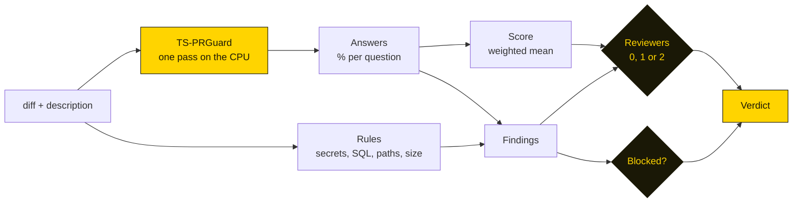

# Policy and model

The policy is `.github/pr-guard.yml` (`--policy` to move it). A missing file, or any key left out, means the default:
[`src/default-policy.yml`](../src/default-policy.yml), which is also what `pr-guard init` prints.

## How a verdict is made



1. **Rules** run first and need no model: secrets, destructive SQL, sensitive paths, big changes, dependency changes.
   What the file list settles is answered here too: a change of documentation, tests, build files or whitespace only
   has its type set and "tests not applicable" without asking the model.
2. **The model** answers each question with the probability of every answer.
3. **The score** is the mean of the answers on the safe side (100% = safe), weighted by the policy.
4. **Reviewers** come from the score (`reviewers.none`, `reviewers.one`); a warning asks for at least one, a block for
   two, code in a language the model was not evaluated on for at least one.
5. **Blocked** when a finding is at `block` level and the mode is `enforce`.

The comment's "How pr-guard decided" shows this arithmetic for each pull request.

## The file

```yaml
mode: shadow                 # shadow: report, never fail · enforce: the status can fail and wait for approvals
model: pr-guard:1            # see "Choosing the model"

reviewers:
  none: 85%                  # score at or above: no review needed
  one: 60%                   # at or above: one reviewer; below: two

questions:                   # warn / block when the risky answer is more likely than this
  description:   { weight: 2, warn: 40%, block: 70% }
  vulnerability: { weight: 3, warn: 70% }
  breaking:      { weight: 2, warn: 50% }
  tests:         { weight: 2, warn: 50% }
  size:          { weight: 1, warn: very large }   # trivial, small, medium, large, very large

rules:                       # block, warn, note or off
  secrets: block
  destructive_sql: block
  big_change: { lines: 800, level: warn }
  dependencies: note
  sensitive_paths:
    level: warn
    paths: [.github/workflows/**, "**/auth/**", "**/migrations/**", "**/Dockerfile", "**/*.tf", "**/.env*"]

skip_label: pr-guard:skip    # this label skips the check
auto_merge: false            # label PRs that need nobody pr-guard:auto-merge
```

| Key | Meaning |
|---|---|
| `questions.<q>.weight` | how much the answer counts in the score; `0` leaves it out |
| `questions.<q>.warn` | warning (at least one reviewer) above this probability of the risky answer; `off` never |
| `questions.<q>.block` | block (two reviewers, fails the status in `enforce`) above this; `off` never |
| `rules.<rule>` | `block`, `warn`, `note` (informs, changes nothing) or `off` |
| `languages` | languages the model was evaluated on; other code is "not evaluated" and never auto-merges |
| `publish` | `comment`, `labels`, `status`, `reviewers`: what is written on the pull request ([hosts](hosts.md)) |

Why vulnerability only warns by default: on the model's held-out set a warning from 70% is 95% precise, but that set is
more than half real security fixes, and real pull requests almost never are. On the [example
projects](../examples) it flagged 6 of 27 clean changes. Add `block:` once it is right on your code.

## Choosing the model

`--model`, else `$PR_GUARD_MODEL`, else `model` in the policy:

| Value | What it is |
|---|---|
| `pr-guard:1` (default) | TS-PRGuard v1, pinned: the exact files this release of pr-guard was tested with, checked by SHA-256 |
| `pr-guard` | the newest release this pr-guard knows |
| `pr-guard:latest` | the newest TS-PRGuard published on [Hugging Face](https://huggingface.co/typestrict/TS-PRGuard), before a pr-guard release pins it |
| `hf:<owner>/<repo>[@<revision>]` | any Hugging Face repo with the same files: a model you trained on your own pull requests with [typestrict.ai](https://typestrict.ai); `$HF_TOKEN` for a private repo |
| `https://…` | a base URL serving `decision_ai.json`, `tokenizer.json` and `onnx/model_8bit.onnx` (a CDN or an internal mirror); put the version in the URL |
| a directory | used as it is |

Packages are kept in `$PR_GUARD_CACHE`, else `~/.cache/pr-guard` (`%LOCALAPPDATA%\pr-guard` on Windows), downloaded once
and checked file by file against the SHA-256 their manifest lists. A branch (`latest`, `@main`) is resolved to its commit
on each run, so a new push is a new download. `pr-guard model pull [model]` downloads ahead of time (Docker images,
runners without internet at check time); `$PR_GUARD_HF_ENDPOINT` points the Hub downloads at a mirror.
